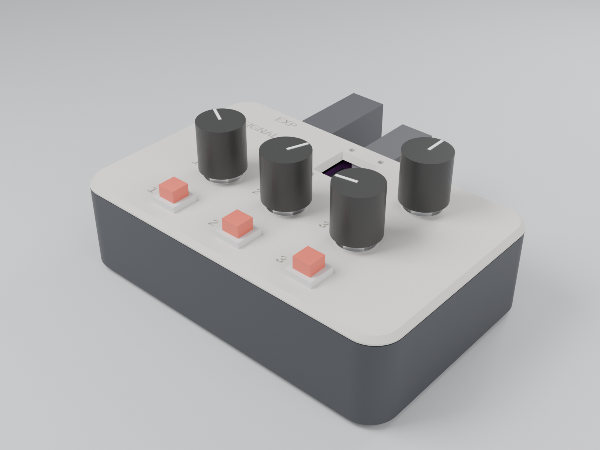

# SignalPatch C3 enclosure

A two-part printed case for the C3 handheld controller: a shell and a lid
that carries the controls. 116 x 74 x 31.4 mm, knobs up to 21 mm above the
lid. Nothing here has been printed or tested; see "Not tested".

| Render | What it shows |
| --- | --- |
| [top](images/02-top.png) | the panel: three pots, the encoder, three buttons, the OLED window with the two LED holes above it and the BOOT / RST pin holes below |
| [far wall](images/03-far-wall.png) | the USB-C notch with the receptacle flush, the expression jack's hole |
| [lid off](images/04-lid-off.png) | the ESP32-C3 board on its stand, the MPU-6050 on its bosses, the jack's body |
| [section through the board](images/06-section-c3.png) | the stack: stand, tape, board, OLED under the 45-degree window, receptacle in the wall slot |
| [section through the pots](images/07-section-pots.png), [through the jack](images/08-section-jack.png) | the parts hanging from the lid, the jack between floor and lid |
| [exploded](images/05-exploded.png), [print plates](images/09-print-plates.png) | the two parts, and the two parts as they print |

## Status

From `python3 gen/build.py` (the last line of its log says `DONE`):

| check | result | status |
| - | - | - |
| measurement check | 6 differences over 0.3 mm, 6 reviewed | pass |
| STL export | shell.stl, lid.stl | pass |
| additions survive the cuts | 0 lost | pass |
| judge self-test | 18 faults planted, 18 caught and named | pass |
| collisions (OpenSCAD) | 0 found, 0 reviewed | pass |
| margins | 100 checked, 0 failing | pass |
| mesh self-test | 6 faulty meshes, 6 caught | pass |
| mesh (Blender) | closed, on the bed, walls and bridges | pass |
| renders | 9 images in images/ | pass |

The six "differences" are gaps in the sources, not disagreements: no
published PCB thickness, no drawing of how the OLED sits on the board, its
position measured from photos, the USB-C overhang from one measurement, no
maker drawing for the 7 mm buttons, and the jack makers' drawings not
downloadable. Each is reviewed in `gen/spec.py` and SPEC.md section 3, and
the case is drawn for the worst case of each.

## Print

| File | Orientation | Notes |
| --- | --- | --- |
| `stl/shell.stl` | floor down (as exported) | no supports |
| `stl/lid.stl` | top face down (as exported) | no supports; the lettering is in the bed face, so turn elephant-foot compensation on |

0.4 mm nozzle, 0.2 mm layers, a 220 x 220 mm bed (each part fits on its
own). PETG preferred, PLA works. Three perimeters (1.2 mm) keep the walls
solid around the holes. Widest bridge 8.9 mm (the counterbores), no
overhang past 45 degrees, thinnest wall 0.9 mm (the skin over the pots'
tab pockets).

## Buy

Case hardware:

- 4 x M3 x 8 socket head screws (ISO 4762)
- 4 x M3 x 5.7 heat-set inserts (Ruthex RX-M3x5.7 or CNC Kitchen M3 x 5.7)
- 2 x M2 x 6 thread-forming screws for plastic, for the MPU-6050
- 1 mm double-sided foam tape, about 12 x 20 mm
- 4 x 3M Bumpon SJ5302 feet (optional)

Parts the case is drawn for (wiring in `../README.md`):

- the ABrobot "ESP32-C3 OLED" board (25.0 x 20.5 mm, 0.42" OLED). The
  01Space ESP32-C3-0.42LCD is a different board and does not fit.
- 3 x Alpha 9 mm pots with an M7 bushing (RD901F-40 / RV09 type), 10k linear
- an EC11 encoder with push switch and M7 bushing (15 or 20 mm shaft)
- 3 x 7 mm momentary buttons (PBS-110 type)
- a 1/4" stereo jack, Switchcraft 112BX or Cliff S4
- a GY-521 (MPU-6050) board
- knobs up to 16 mm across and 18 mm tall

## Assemble

1. Press the four inserts into the tips of the lid's pillars (4.0 mm holes,
   7.5 mm deep) with a soldering iron.
2. Fit the pots, the encoder and the buttons in the lid with their washers
   and nuts. The pots' pins point toward the far edge; a pot with an
   anti-rotation tab puts it in the small pocket beside its hole. Knobs go
   on last.
3. Stick the foam tape on top of the stand in the shell. Set the ESP32-C3
   board on it OLED up, slide its USB-C edge into the slot in the far wall
   until it stops, then press it down. The two ears at the other end hold
   its corners.
4. Screw the MPU-6050 onto its two bosses with the M2 screws, pins toward
   the middle of the case.
5. Fit the jack through the far wall, washer and nut outside.
6. Wire everything as in `../README.md`. Keep wires clear of the lid's lip
   (it reaches 3 mm below the lid) and off the stand's top.
7. Lower the lid: its pillars land on the floor bosses. Drive the four
   M3 x 8 screws up through the floor.
8. Stick the feet into the four recesses underneath.

BOOT and RST can be pressed through the two small holes below the OLED
window with a paper clip.

## Not tested

Nothing has been printed, and nothing has been fitted. The checks prove
that the drawn parts fit the drawn case, that the meshes print without
supports, and that every margin holds with the tolerances above. They do
not prove:

- the parts you buy match the drawings. Measure first: the 7 mm buttons
  must not reach more than 24 mm below the lid's top face (29 mm overall
  with 5 mm above the panel), and the jack's body must be at most
  21 x 23 x 28 mm behind the wall.
- the ESP32-C3 board's real thickness and how high its OLED sits. The case
  takes 0.8 to 1.6 mm boards and 1.25 to 2.6 mm OLED stacks; the window is
  sized for that, so the OLED's glass may sit up to 6.2 mm below the top.
- how the prints come out: hole sizes, the inserts' grip, the M2 screws in
  their pilots, the 0.95 mm slot for the board's edge.
- how it feels in the hand, and whether the gyro's axes need swapping
  (`../include/Pins.h`).

Print the lid first and test-fit a pot, the encoder and a button; then the
shell, and check the board in its slot before wiring.

## Files

- `gen/spec.py`: the design (positions, stack-up, checks); `gen/parts_lib.py`:
  every part's numbers and sources; `python3 gen/build.py` rebuilds
  everything (about 10 minutes with renders, `--no-render` 2).
- `SPEC.md`: the stack-up and the sources; `DECISIONS.md`: the choices and
  their alternatives; `SKILL-FEEDBACK.md`: notes on the design kit.
- `signalpatch-c3.scad`: both parts in place, for OpenSCAD.
